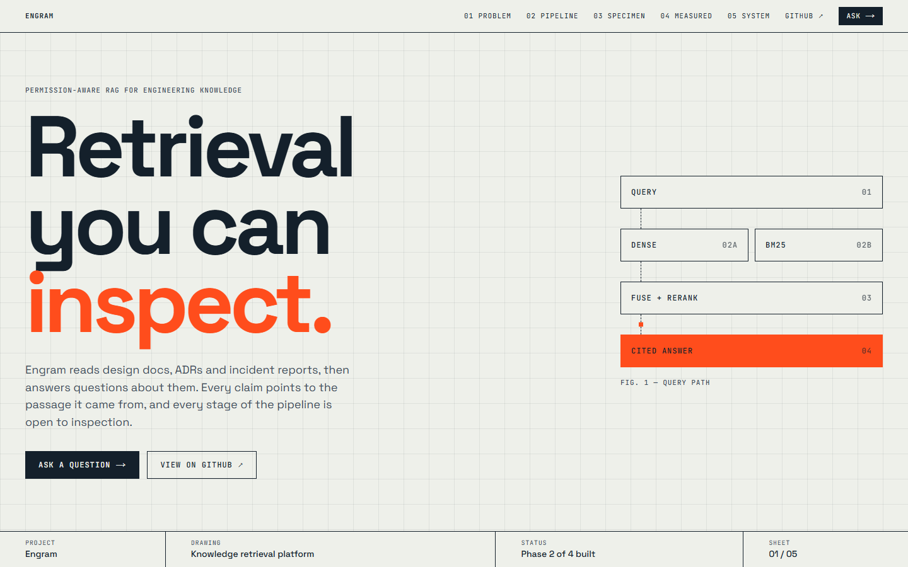
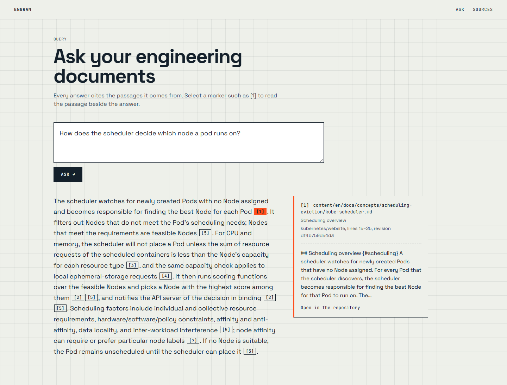
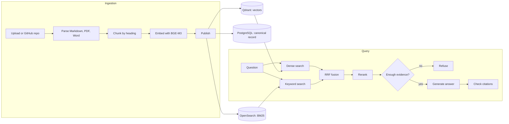

# Engram

Engram answers questions about engineering documents and cites the exact passage behind every claim. When the evidence isn't there, it says so instead of guessing.

It is being built in four phases as a multi-tenant, permission-aware retrieval-augmented generation (RAG) platform for engineering knowledge such as design docs, ADRs and incident reports. Phases 1 and 2 are complete: ingestion, hybrid search, reranking, cited answers, and an evaluation harness that measures retrieval quality.



## Highlights

- **Hybrid retrieval with reranking.** Each question runs dense search (BGE-M3 vectors in Qdrant) and keyword search (BM25 in OpenSearch) in parallel. The two rankings are merged with Reciprocal Rank Fusion, and a cross-encoder (BGE-reranker-v2-m3) rescores the merged candidates.
- **Refuses rather than guesses.** The reranker's score decides whether there is enough evidence to answer. Its cutoff was chosen on a held-out `dev` split. On the `test` split it answered 72 of 73 answerable questions and refused all 12 unanswerable ones.
- **Citations that resolve.** Every marker in an answer must point to a passage that was actually retrieved, and invalid markers are removed. Passages reach the model as delimited data with instructions never to follow text inside them, so a document can't override the system's rules.
- **Structure-aware chunking.** Documents are split by heading, not into fixed-size windows. Each chunk keeps its heading path, line or page range and source revision, so a citation opens the exact section of the exact commit.
- **One canonical store.** PostgreSQL holds the record, and Qdrant and OpenSearch are projections that can be rebuilt from it. Content hashes make ingestion idempotent, and the embedding model version is stored so content can be re-embedded when the model changes.
- **Permission-aware from the schema up.** Every record carries a tenant and access principals, and both searches filter on them before anything is retrieved. Today everything runs in one default tenant. Sign-in and per-user enforcement arrive in Phase 3.
- **Measured, not assumed.** An evaluation harness scores four retrieval configurations on 142 hand-written questions with gold answer sections. It reports Recall@K, MRR and NDCG, checks differences between configurations with a paired significance test, and calibrates the evidence cutoff.

## See it work



This is a real answer from the running stack, over 186 pages of the Kubernetes concepts documentation. Selecting `[1]` opens the cited passage with its file, section, line range and commit.

## How it works



The system is a modular monolith: a FastAPI backend, a Next.js frontend and three data stores, run with Docker Compose. Embedding runs locally, on a GPU when there is one and on the CPU otherwise, or in bulk in a Kaggle notebook (`notebooks/kaggle_embed.ipynb`). Answers come from a model reached through OpenRouter, with a fallback model if the first one fails.

## Results

Retrieval quality on the 73 answerable questions in the `test` split:

| Configuration | Recall@5 | Recall@10 | MRR@10 | NDCG@10 | Median retrieval latency |
|---|---:|---:|---:|---:|---:|
| Dense (BGE-M3) | 0.890 | 0.945 | 0.807 | 0.849 | 49 ms |
| Hybrid (dense + BM25, RRF) | 0.836 | 0.877 | 0.763 | 0.793 | 47 ms |
| Dense + rerank | 0.849 | 0.945 | 0.817 | 0.865 | 941 ms |
| **Hybrid + rerank (served)** | **0.890** | **0.973** | **0.824** | **0.872** | 840 ms |

What the numbers show:

- Hybrid with reranking ties dense on Recall@5 and leads on Recall@10, MRR and NDCG.
- The reranker's clearest gain is in deciding when to refuse. With a cutoff calibrated on `dev`, it refused 12 of 12 unanswerable `test` questions, against 6 of 12 for dense similarity at its configured cutoff, while still answering 72 of 73 answerable ones.
- Hybrid search without reranking does worse than dense alone. Whether BM25 earns its place isn't proven on this dataset.
- None of the differences between configurations is statistically significant (exact McNemar test). Each gap is a few questions.
- Latency was measured on a laptop GPU, with retrieval only and no generation.

These results are **provisional**. The questions were written for this project by its author from the corpus, and their gold labels are still awaiting an independent review. [`docs/phase-2-evaluation.md`](docs/phase-2-evaluation.md) has the full results, the method and the limits, including a manual review of 25 answer citations.

## Tech stack

| Area | Tools |
|---|---|
| Backend | Python 3.12, FastAPI, SQLAlchemy, Alembic, Pydantic Settings |
| Retrieval | BGE-M3 and BGE-reranker-v2-m3 (sentence-transformers, PyTorch), Qdrant, OpenSearch |
| Data | PostgreSQL |
| Frontend | Next.js 16, React 19, TypeScript, GSAP, Lenis |
| Infrastructure | Docker Compose, Caddy |
| Quality | pytest (508 tests against real PostgreSQL, Qdrant and OpenSearch), Vitest and Testing Library (75 tests), ruff, ESLint |

Each phase started from a written design and an implementation plan, in [`docs/specs/`](docs/specs/) and [`docs/plans/`](docs/plans/), and was built test-first. [`Plan.md`](Plan.md) holds the full proposal.

## Status and roadmap

| Phase | Scope | Status |
|---|---|---|
| 1. Foundation | Ingestion from uploads and GitHub, structure-aware chunking, dense retrieval, cited answers, frontend | Done |
| 2. Advanced retrieval | OpenSearch BM25, hybrid search, RRF, reranking, evidence calibration, evaluation harness | Done |
| 3. Enterprise features | Sign-in, tenant and permission enforcement, Celery workers with Redis, incremental sync, deletion propagation | Planned |
| 4. Deployment | CI/CD, observability, load testing, production sizing | Planned |

Known limits today:

- There's no sign-in, and every request runs in one default tenant.
- Ingestion jobs run inside the API process.
- Files deleted at the source stay searchable.
- Only Markdown, PDF and Word files are read.

## Running it locally

You need Docker, Python 3.12, [uv](https://docs.astral.sh/uv/) and Node.js 20 or later.

Start the services from the repository root:

```bash
docker compose up -d
```

| Service | Role | Address |
|---|---|---|
| PostgreSQL | Canonical record: tenants, sources, documents, chunks, jobs, query log | `127.0.0.1:15432` |
| Qdrant | Dense vectors (BGE-M3), a projection of PostgreSQL | `127.0.0.1:6333` |
| OpenSearch | BM25 keyword index, a projection of PostgreSQL | `127.0.0.1:9200` |

Then run these commands from `backend/`:

| Task | Command |
|---|---|
| Install dependencies | `uv sync` |
| Run the API | `uv run uvicorn app.main:create_app --factory --reload` |
| Run all tests | `uv run pytest` |
| Run one test | `uv run pytest tests/test_health.py::test_health_ok -v` |
| Lint | `uv run ruff check .` |
| Rebuild the keyword index from PostgreSQL | `uv run python -m app.cli reindex-keyword` |

Tests use the real PostgreSQL, Qdrant and OpenSearch services, so start them first. The tests
that load the real reranker are marked `slow` and skip unless its weights are already in the
Hugging Face cache (`HF_HOME`).

A question runs dense search in Qdrant and BM25 search in OpenSearch in parallel, merges the
two rankings with Reciprocal Rank Fusion, and rescores the candidates with
BGE-reranker-v2-m3. The reranker's score decides whether there is enough evidence to answer
(`rerank_min_score`, chosen on the evaluation's `dev` split). The API downloads BGE-M3 and the
reranker into `HF_HOME` on first use. Set it to keep them on a disk with room for about 6 GB.

`reindex-keyword` fills an empty or rebuilt OpenSearch index with the current version of every
document. Ingestion fills the index as it publishes, but a database that already held documents
before OpenSearch was added starts with an empty keyword index, so BM25 finds nothing until you
run it. With the production Compose file, run it inside the API container from the repository
root:

```bash
docker compose -f docker-compose.prod.yml --env-file .env.prod exec api python -m app.cli reindex-keyword
```

The reranker's latency was measured on the development laptop's GPU only (about 800 ms per
question). Its latency on the production server's CPU is unmeasured. Phase 4 measures it, with
the memory OpenSearch and the reranker need, before choosing the server size. To run without
the reranker, add `RERANK_ENABLED: "false"` and `RETRIEVAL_MODE: dense` to the `api` service's
`environment` in `docker-compose.prod.yml`. The two go together, because an unreranked hybrid
ranking has no score that can decide whether there is enough evidence.

### Evaluation

`backend/eval/` holds 142 questions about the Kubernetes concepts documentation, with gold
sections, and the harness that measures retrieval on them. `backend/eval/README.md` describes
the corpus, how the questions were written and the split rule. Run these from `backend/` with
the services up and the corpus ingested:

| Task | Command |
|---|---|
| Check every gold label against the corpus | `uv run python -m eval.check` |
| Measure one configuration (`dense`, `hybrid`, `dense_rerank` or `hybrid_rerank`) | `uv run python -m eval.run --config hybrid_rerank` |
| Choose the evidence cutoff on the `dev` split | `uv run python -m eval.calibrate --config hybrid_rerank` |
| Ask the answer-review sample through the model | `uv run python -m eval.answers` |
| Rebuild the results document | `uv run python -m eval.report` |

The results are in [`docs/phase-2-evaluation.md`](docs/phase-2-evaluation.md). They stay
provisional until the owner has reviewed a sample of the questions and their gold labels.

### Frontend

The frontend has three pages:

| Page | What it is |
|---|---|
| `/` | Landing page: what Engram is, how the pipeline works, and what is built so far |
| `/ask` | Ask a question and read the cited answer |
| `/sources` | Upload documents, connect GitHub repositories and watch ingestion jobs |

The landing page's content lives in `frontend/lib/system.ts`. Each stage, store and phase there is marked `live` or `planned`, and the page draws planned parts dashed. Update that file when a phase lands. Its `MEASURED` numbers are copied from `backend/eval/results/*.json`, and a test fails if they drift, so update them after rerunning `eval.run`.

Run these commands from `frontend/`. The development server forwards `/api` requests to the API on port 8000, so start the API before using `/ask` or `/sources`. The landing page works without it.

| Task | Command |
|---|---|
| Install dependencies | `npm install` |
| Run the app on port 3000 | `npm run dev` |
| Run all tests | `npm test` |
| Run one test file | `npm test -- components/AnswerView.test.tsx` |
| Lint | `npm run lint` |
